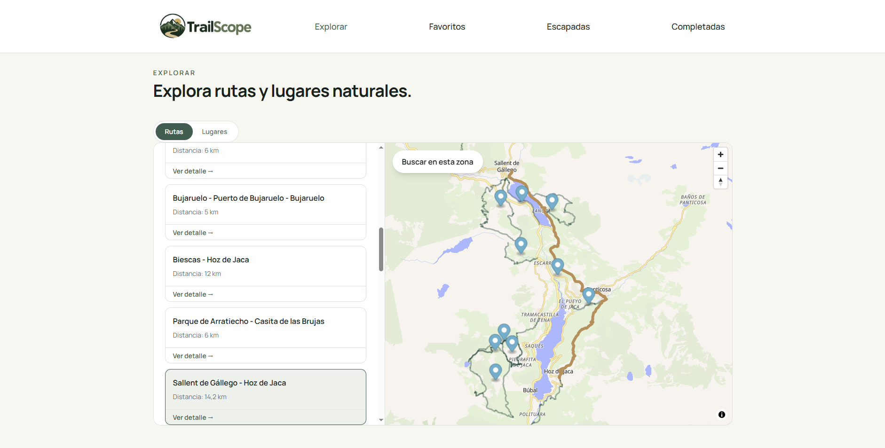
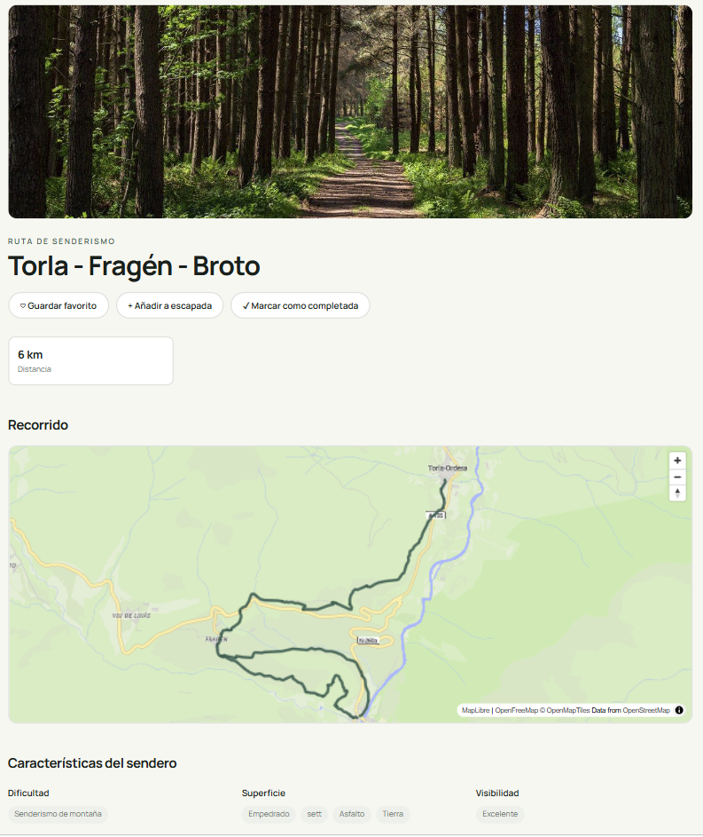
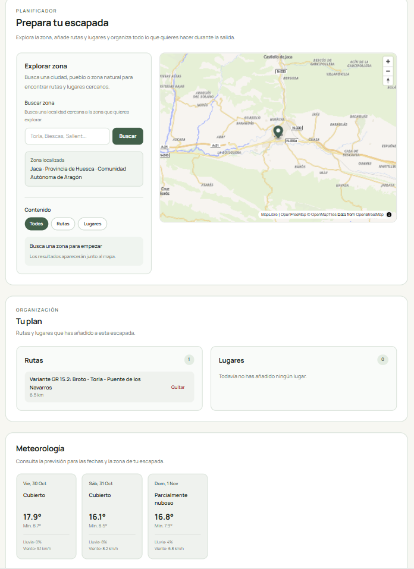

  

TrailScope es una aplicación web para **descubrir rutas de senderismo y lugares naturales, guardar favoritos y planificar escapadas**.

Es un proyecto de portfolio centrado especialmente en **React, frontend visual, consumo de APIs, mapas interactivos y experiencia de usuario**.

---

### Explorar rutas y lugares

### Detalle de una ruta

### Planificación de una escapada

## Funcionalidades

### Explorar

Permite buscar dentro de una zona del mapa:

- rutas de senderismo
- cascadas
- miradores
- lagos

Los resultados se muestran mediante tarjetas y sobre un mapa interactivo. Cada ruta o lugar dispone además de su propia página de detalle.

### Favoritos

Las rutas y lugares pueden guardarse para consultarlos posteriormente.

### Escapadas

El usuario puede crear escapadas con destino, fechas y notas, buscar contenido cercano y añadir rutas o lugares a su planificación.

### Meteorología

Las escapadas pueden mostrar la previsión meteorológica disponible para el destino y las fechas seleccionadas.

### Rutas completadas

Las rutas realizadas pueden marcarse como completadas y mantenerse como historial de actividad.

---

## Tecnologías

- **React**
- **Vite**
- **JavaScript**
- **React Router**
- **Tailwind CSS**
- **MapLibre GL JS**
- **localStorage**

TrailScope es actualmente una aplicación frontend sin backend, base de datos ni autenticación.

---

## APIs y servicios externos

TrailScope trabaja con información real obtenida mediante servicios externos:

- **OpenStreetMap + Overpass API** — rutas y lugares naturales
- **Open-Meteo** — meteorología y búsqueda de localidades
- **MapLibre GL JS + OpenFreeMap** — representación cartográfica

**© OpenStreetMap contributors**

Al depender de APIs externas, determinadas búsquedas pueden tardar, fallar temporalmente o no disponer de información suficiente para una zona concreta.

---

## Persistencia

Favoritos, escapadas y rutas completadas se almacenan mediante `localStorage`.

Esto permite conservar la información entre sesiones en el mismo navegador, aunque actualmente no existe sincronización entre dispositivos ni cuentas de usuario.

---

## Diseño y experiencia de usuario

El apartado visual ha sido uno de los objetivos principales del proyecto.

Se ha trabajado especialmente en:

- diseño responsive
- jerarquía visual y espaciado
- consistencia entre componentes
- interacción con mapas
- tarjetas y estados visuales
- navegación en escritorio y móvil

La identidad de TrailScope utiliza tonos relacionados con naturaleza, montaña y senderismo.

---

## Recursos visuales

Las fotografías de rutas, paisajes y lugares naturales utilizadas en TrailScope proceden de **Wikimedia Commons**.

El logotipo y la identidad visual han sido creados específicamente para el proyecto.

---

## Uso de Inteligencia Artificial

La IA se ha utilizado como herramienta de apoyo para resolver dudas, revisar código, mejorar documentación y apoyar determinadas decisiones de desarrollo.

Durante la fase final también se utilizó **OpenAI Codex para realizar una revisión global del proyecto** antes de su publicación.

---

## Decisiones principales

- **Frontend sin backend:** el objetivo de esta versión era profundizar en React, APIs, mapas y experiencia de usuario
- **localStorage:** permite incorporar persistencia sin añadir una infraestructura innecesaria para el alcance actual
- **Datos reales:** rutas, lugares y meteorología proceden de servicios externos en lugar de datos simulados
- **MapLibre:** permite representar rutas y lugares de forma interactiva mediante tecnologías abiertas

---

## Qué he trabajado

TrailScope me ha permitido reforzar principalmente:

- React y componentes
- estado y efectos
- React Router
- consumo y transformación de APIs
- asincronía y tratamiento de errores
- MapLibre y GeoJSON
- `localStorage`
- Tailwind CSS y responsive design
- organización de proyectos frontend
- Git y GitHub
- revisión y depuración de código

---

## Limitaciones

Actualmente:

- no dispone de cuentas de usuario
- no sincroniza datos entre dispositivos
- depende de la información disponible en OpenStreetMap y otros servicios externos
- la meteorología está limitada al periodo de previsión disponible
- no debe utilizarse como herramienta profesional de navegación o seguridad en montaña

---

## Posibles mejoras

En futuras versiones podrían incorporarse autenticación, base de datos, sincronización, más filtros y categorías, mejoras de accesibilidad y tests automatizados.

---

## Estado

**Versión actual:** funcional y en fase final de publicación.

Proyecto desarrollado como parte de mi portfolio personal de desarrollo web.
